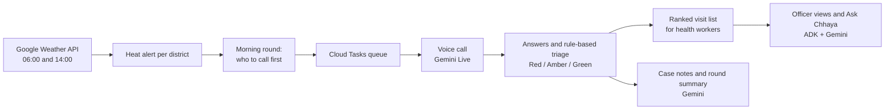

# Chhaya

AI wellness-check calls during heatwaves and cold waves. When a warning is issued for a
district, Chhaya phones vulnerable residents in their own language, triages their answers,
and gives frontline workers a ranked visit list.

Built for the AI Builder Cup 2026, theme **Sustainability & Social Impact**.

**Live app:** https://chhaya-pgz66tuq7a-el.a.run.app

## Try it

- **Talk to Chhaya:** open "Try a call" and speak to the voice agent in your browser (English, Hindi or
  Marwari). The transcript, the answers it records and the resulting tier appear as you talk.
- **Regional officer view:** districts under a heat warning, the morning round of calls, urgent Red cases,
  the situation report, and **Ask Chhaya**, an assistant that answers plain questions from the live data.
- **Field crew view:** a health worker's visit list, ranked by need, with what to bring.
- **How we test Chhaya** (`/evidence`): simulated calls, assistant checks, speed, and what we have not
  tested yet.
- The app opens on live data (Google Weather for 16 districts); "Demo data" switches to a fixed heat day
  with simulated residents and calls.

## How it works



**Google technology used**

- **Gemini Live** (Vertex AI) for the voice calls: speech in and out, tool calls to record answers and flag
  emergencies, in the resident's language.
- **Gemini** text models (Vertex AI) for case notes, round summaries and Ask Chhaya; a Flash-Lite model as
  Ask Chhaya's topic check.
- **Agent Development Kit (ADK)** for Ask Chhaya (a root agent with specialist agents and data tools) and
  `adk eval` for its evaluation.
- **Cloud Run** (the service and web app), **Firestore** (data), **Cloud Tasks** (the call queue), **Cloud
  Scheduler** (weather fetches, call sweeps, the daily demo rebuild), **Secret Manager** (keys), and the
  **Google Weather API**.
- Phone calls go through Twilio to Gemini Live; triage is fixed rules, so an AI answer can raise a tier
  but never hide a Red case.

## How we test Chhaya

Simulated check-in calls in English, Hindi and Marwari, and Ask Chhaya checked question by
question on a fixed dataset, with every result dated and labelled with the model that
produced it. The method, the results and how to re-run them: [EVALUATION.md](EVALUATION.md).
The same results are on the app's "How we test Chhaya" page (`/evidence`).

## Run the backend locally

Requires Python 3.11 or 3.12.

    cd backend
    python -m venv .venv
    source .venv/Scripts/activate      # Windows Git Bash; use .venv/bin/activate elsewhere
    pip install -r requirements.txt
    cp .env.example .env
    python -m pytest
    uvicorn app.main:app --port 8000

With `STORE=memory` and `SEED_ON_START=true` the server starts with the seed: sixteen real
districts in four states (see "Role views"), three real wards in each and 30 to 50 mocked
residents in each ward, and keeps everything in memory. Admin and internal endpoints
need the header `X-Internal-Secret` with the value of `INTERNAL_SECRET`.

To put your own phone on the first residents, set `TEAM_PHONES=+91...,+91...` in `.env`.
Each number must be in international format (a plus sign, then 8 to 15 digits, no spaces)
and at most 30 are accepted; otherwise the server refuses to start and names the bad entry.

The round report (`/api/rounds/{round_id}/report`) counts `not_callable` separately from
`targeted`: residents who agreed to be called but whose stored number cannot be dialled.

## Run the frontend locally

The web app is located in `web/` (React 19 + Vite + TypeScript).

### Option A: Vite Dev Server (Fastest for frontend development & hot-reload)

Use Node.js 22.14 or newer (the locked Vite toolchain requires at least Node 20.19 or 22.12).

    cd web
    npm install
    npm run dev

Open `http://localhost:3000`. API calls (`/api`, `/admin`, `/internal`, `/browser`) automatically proxy to port `8080`. Built-in mock fallbacks are included so you can preview all screens even if the backend is offline.

### Option B: Build & Stage with the FastAPI Backend

To build the static distribution and serve everything unified under FastAPI at `http://localhost:8080/`:

    cd web
    npm run build
    python ../backend/scripts/stage_web.py

Then start the backend as described above (`uvicorn app.main:app --port 8080`).

Available routes:
- `/` — The web-app branch's split regional/ward role gateway
- `/regional/overview` — Analytics with shared geographic filters and the Chat/Agent panel
- `/regional/districts` — State, district, ward, and resident directory
- `/regional/critical` — Scoped priority cases; residents open in an in-place modal
- `/regional/team`, `/regional/report` — Backend-backed roster and printable scope report
- `/regional/dispatch` — Action approvals, provider receipts, and activity history
- `/regional/agent-tester` — Explicitly scripted preview plus a link to the real microphone flow
- `/ward/overview`, `/ward/visits`, `/ward/map` — Field crew workspace, visit queue, and recorded locations
- `/crew`, `/visit`, `/report`, `/welcome` — Compatibility redirects preserving query parameters
- `/alert` — Original alert and risk-ranked residents demo
- `/call` — Real character picker, microphone check, and live call feed
- `/evidence` — Safety benchmark results and guarantees
- `/team` — Team mode control panel

## Operations dashboard

The operations views use the `web-app` branch's sidebar and regional/ward layouts, with
backend-backed projections in `web/src/lib/operationalData.ts`. Geographic scope persists
across regional sidebar navigation. Field crew see their assigned area instead of the
admin's geographic filters; stale state/district/ward parameters are ignored and removed
from ward URLs. A collapsible worker switcher is available only in the synthetic demo.
Resident links open the shared native dialog on the current page,
including from map pins; unassessed residents get an explicitly unassessed record view.
The admin assistant retains the active thread across page navigation and requires a new
thread when the geographic scope changes. The browser-only `roleData.ts` simulation is used
for the clearly labeled scripted voice preview, not as the source of operational records.
Hourly forecasts and unregistered facilities are not fabricated to populate charts or maps.
Ward interface translations live in `web/src/lib/wardLocale.ts`; reason translations are
keyed by the backend's stable rule IDs and must be updated when those IDs change. Hindi
and English preferences persist across ward pages. Original names, free-text notes, and
conversation transcripts are not silently translated or rewritten.

State/district names are a snapshot of
NIC's Integrated Government Online Directory, retrieved on 2026-10-13: Rajasthan (41),
Telangana (33), Madhya Pradesh (55), and Maharashtra (36). Each state includes its source
link. These are names, not administrative boundaries or health statistics. Only onboarded
wards are shown. The seed covers sixteen districts, four in each state (Rajasthan: Churu,
Bikaner, Jhunjhunu, Sikar; Telangana: Jayashankar Bhupalapally, Jogulamba Gadwal, Narayanpet,
Yadadri Bhuvanagiri; Madhya Pradesh: Dewas, Katni, Ratlam, Shahdol; Maharashtra: Raigad,
Sangli, Solapur, Yavatmal), with three real wards each taken from official lists (the sources
are in `backend/seed/fixtures/wards.json`). The residents in them are mocked. Ward ids are
`{district}-ward-{n}` and worker ids `{district}-worker-{n}`. Only Rajasthan is under the heat
alert; the other twelve districts are `register_only`. Other districts show no operational
data until a registry and rounds are loaded.

Start the backend on port 8080 when using the default Vite proxy, or set `VITE_BACKEND_URL`
for the frontend process to match your backend's port. The new operations pages have no
fabricated fallback metrics. `/report` also shows only API-backed figures.

Without Google sign-in, the operations dashboard creates a cookie-bound synthetic demo
workspace. Admin/Crew switching is available there; assignments, visits, proposals and chat
history belong to that session. Demo notifications never call Twilio. Demo changes do not
alter the shared round. The integrated regional report includes that session's
operations task overlays. The underlying legacy `/api/rounds/{id}/report` still describes
the shared round, not a visitor's isolated task overlays.

For real role-based access, configure the existing Google sign-in settings and:

```dotenv
OPERATIONS_ADMIN_EMAILS=admin@example.com
OPERATIONS_CREW_ACCOUNTS={"crew@example.com":"worker-a"}
```

Both accounts must also be in `ALLOWED_EMAILS`. Crew IDs must match documents in `workers`.
Unmapped signed-in users cannot use operations APIs. Configuring these role mappings also
prevents crew accounts from using legacy admin routes. The internal secret retains machine
administrator access; never give it to crew or place it in client-side environment variables.

Assistant conversations use the existing `TEXT_MODEL`, `GCP_PROJECT`, `TEXT_LOCATION` and
Vertex application-default credentials. Chat is read-only. Agent mode can draft crew
assignments, crew SMS briefings and resident notification calls. Every draft is validated
against the selected records and requires a separate approval. History retains timestamps,
source case IDs, scope, snapshot counts, model identity and prompt version. If Gemini is
unconfigured or fails, the UI says so rather than pretending to be an AI assistant.

Use `STORE=firestore` for history across backend restarts. Operations records use the existing
Store interface and collections prefixed `ops_`; no direct browser database access is used.
`STORE=memory` is intentionally ephemeral and the UI displays a warning. Firestore must
already exist and have appropriate service-account access; changing STORE does not migrate
the in-memory demo or populate a registry automatically.

For actual notifications, sign in as an operations admin and configure the existing
`TWILIO_ACCOUNT_SID`, `TWILIO_AUTH_TOKEN`, `TWILIO_FROM`, `PUBLIC_HOST` and `DIAL_ALLOWLIST`.
Recipient numbers come from resident/worker documents, not from model-generated text.
Trial recipients must be verified with Twilio and explicitly allowlisted. Resident calls
also require consent and permitted calling hours. Notification calls are a short reviewed
TwiML announcement (English/Hindi), distinct from the existing Gemini wellness conversation.
Crew notification currently uses SMS, not WhatsApp. No automatic emergency-service call is
made by the crew's “Flag for admin attention” action.

Signed delivery receipts are accepted at `/twilio/operations/status`. Receipt timestamps
record when Chhaya received the callback, not a claimed exact handset delivery time. Provider
completion does not imply a resident understood the message or a crew member acknowledged.
Repeated approval of the same proposal never automatically resends. If submission cannot be
confirmed, the action is marked `needs_review`; inspect Twilio before creating a new draft.

### Isolated local verification

These commands use synthetic data and do not load `.env`, call Gemini, contact Firestore,
or send notifications:

```bash
cd web
npm ci
npm run build
npx playwright install chromium
```

In another terminal, from `backend`, run:

```bash
python -m tests.operations_server
```

Open `http://127.0.0.1:8091/`. From `web`, run `npm run test:e2e`. Backend tests run with
`python -m pytest -q` from `backend`. Browser tests cover geographic filtering, approvals,
resident notification simulation, crew visits, history, mobile layout and backend-backed
report figures. Live credentials and provider behavior must be verified separately.

## Try a call

The voice agent runs on Gemini Live through Vertex AI. The voice model lives in `us-central1`,
so you need `GCP_PROJECT` set in `.env` and Google application-default credentials
(`gcloud auth application-default login`) for a project with Vertex AI enabled.

Calls only happen between `CALL_START_HOUR` and `CALL_END_HOUR` local time. For a test in the
evening, set `CALL_START_HOUR=0` and `CALL_END_HOUR=24` in your local `.env` (for local testing
only; do not do this in a deployment).

1. Start the server and open a round:

       curl -X POST localhost:8000/admin/alerts/replay \
            -H "X-Internal-Secret: dev-secret" \
            -H "Content-Type: application/json" \
            -d '{"district_id":"churu","hazard":"heat","severity":"red"}'

       curl -X POST localhost:8000/internal/rounds/ROUND_ID/dispatch \
            -H "X-Internal-Secret: dev-secret"

   `ROUND_ID` is the `round_id` returned by the replay request. A `null` there means the alert
   was below the threshold that opens a round, so there is nothing to dispatch.

   A call id has the form `<round id>_<resident id>_<attempt>`, for example `ROUND_ID_r01_1`
   for the first attempt at the first resident.

2. Browser call: open `http://localhost:8000/dev/call`, type the internal secret and a call id
   such as `ROUND_ID_r01_1` into the page, and press Start. The page asks for microphone
   access first. Use headphones. The agent speaks first. (With sign-in on, leave the secret
   field empty: being signed in is enough.)

3. Phone call (optional): first change `INTERNAL_SECRET` to a long random value. This must be
   done before `PUBLIC_HOST` or any Twilio setting is filled in: the server refuses to start
   with the default secret once any of them is set, because a server that Twilio can reach can
   be reached by anyone. Then set `TWILIO_ACCOUNT_SID`, `TWILIO_AUTH_TOKEN` and `TWILIO_FROM`
   (all three, or the server refuses to start), `PUBLIC_HOST` (a bare host name Twilio can
   reach, with no `https://`, for example `abc.ngrok-free.app`) and `DIAL_ALLOWLIST` (for
   example `+91XXXXXXXXXX`), put the same number in `TEAM_PHONES`, restart, then (with your
   new secret in place of `YOUR_SECRET`):

       curl -X POST localhost:8000/internal/calls/ROUND_ID_r01_1/dial \
            -H "X-Internal-Secret: YOUR_SECRET"

   Without `PUBLIC_HOST` and `DIAL_ALLOWLIST` the server starts but logs a warning that phone
   calls cannot be placed.

If you answer a test call and say nothing (or hang up before the agent learns anything about a
person), the call is stored as `no_answer` and a retry is queued; no case appears on the ward
list. The simulate endpoint reports the stored status as `{"ok": true, "status": "..."}`.

Only numbers listed in `DIAL_ALLOWLIST` are ever dialled. What the agent says and asks is
defined in the YAML files under `backend/app/call/guidance/`. On Windows, console tools that
print Hindi need `PYTHONIOENCODING=utf-8`.

## Tuning the voice agent

How the agent sounds and how it takes turns is set by the `LIVE_*` variables in `.env`. Change
one, restart the server, make a test call, and compare. Nothing here needs a code change.

| Variable | What it changes | Default |
|---|---|---|
| `LIVE_VOICE` | The voice the agent speaks in (one of the model's prebuilt voices). Empty leaves the model's own default voice. | `Kore` |
| `LIVE_SPEAKS_AS` | `woman` or `man`: which grammatical gender the agent uses for itself in Hindi, Marwari, Marathi and Gujarati. It must match the voice. | `woman` |
| `LIVE_SILENCE_MS` | How long a pause, in milliseconds, ends the person's turn. Too short cuts off slow speakers; too long makes the agent slow to reply. | `700` |
| `LIVE_START_SENSITIVITY` | `default`, `low` or `high`: how readily a sound counts as the person starting to speak. `low` lets a cough, room noise or an echo pass. `default` leaves it to the service. | `low` |
| `LIVE_END_SENSITIVITY` | `default`, `low` or `high`: how readily a pause counts as the person having finished. | `default` |
| `LIVE_PREFIX_PADDING_MS` | How many milliseconds of speech are needed before it counts as started. `0` leaves it to the service. | `200` |
| `LIVE_INTERRUPTIONS` | `false`: the agent finishes its sentence even if the person speaks over it. | `true` |
| `LIVE_QUIET_SECONDS` | When nobody has been speaking for this many seconds in the middle of a call, the agent is prompted to ask whether it can be heard and to ask its last question again. The wait starts when the agent's words have finished playing, or when the person was last heard, whichever is later. Nothing is sent during the greeting, while the agent is recording an answer or ending the call, or once every question is answered. `0` switches this off. | `5` |
| `LIVE_QUIET_LIMIT` | The most such prompts in a row without the person being heard in between. After that the line is left alone until they speak. | `2` |
| `LIVE_MUTE_REPEATS` | `true`: once the agent has asked a question, nothing more it says is passed on to the person, or kept in the transcript, until the person is heard. It is passed on again after a prompt, after a refused answer (the refusal tells the agent what to do), and always once an emergency is flagged. `false` passes everything on. | `true` |
| `LIVE_CLOSING_SILENCE_SECONDS` | Once every question is answered and the agent has not ended the call: after this many seconds of silence the agent is asked for its closing line and goodbye, and after as many again the call is ended for it. At least `1`. | `5` |
| `LIVE_GREETING_GUARD_SECONDS` | The longest the person's audio is withheld (silence is sent in its place) while the first greeting is spoken. What they say meanwhile is discarded, not delayed: the agent never hears it. Their audio is let through as soon as the greeting has been heard, and in any case after this many seconds. `0` switches this off. | `6` |

What to try for the three problems seen on real calls:

- **The agent says it is a woman but sounds like a man.** The voice is now `Kore`, a
  woman's voice, heard on a real call with this model. To try another, set `LIVE_VOICE`;
  keep `LIVE_SPEAKS_AS` matching the voice (for a man's voice, set `LIVE_SPEAKS_AS=man`). A
  name the model refuses stops calls from opening, so try a new name with
  `scripts/live_smoke.py` before it is deployed.
- **The agent asks several things at once.** This is fixed in the script, not by a setting:
  every question in `backend/app/call/guidance/heat.yaml` and `cold.yaml` is now one question,
  and a follow-up is listed under `then:` with the condition (`when:`) for asking it. If it
  still happens, look at the wording of those files and of the `one_question` rule in
  `conduct.yaml`.
- **The line goes quiet.** Whatever the cause, a line on which nobody has spoken for
  `LIVE_QUIET_SECONDS` is now prompted: the agent asks whether it can be heard and asks its
  last question again. This replaces the earlier prompt that came only after an interruption,
  which never fired on the call where the line went quiet. Shorten the wait (3 or 4) if the
  silences still feel long; lengthen it if the agent cuts in on people who are thinking. If
  interruptions are the cause, make them rarer: keep `LIVE_START_SENSITIVITY=low`, and try a
  larger `LIVE_PREFIX_PADDING_MS` (300 to 500). If short sounds still stop the agent, try
  `LIVE_INTERRUPTIONS=false`; the cost is that the person cannot cut in, even to say something
  urgent, until the agent has finished its sentence. If the greeting restarts when the person
  says "hello" over it, raise `LIVE_GREETING_GUARD_SECONDS`.
- **The agent skips a follow-up.** The follow-ups that everyone is asked (`when: always` in
  the YAML) are enforced in code as well as written in the script. Until the person has
  replied once for the question and once for each of those follow-ups, every answer to it is
  refused except the most worrying one, and so is the answer to any later question; the
  refusal tells the agent which follow-up to ask next. A worrying answer that was refused is
  not lost: if the call ends before the follow-ups, it is stored as it was given. After two
  refusals of the same question the answer is accepted, so a call cannot get stuck.
- **The agent asks the same thing twice.** With `LIVE_MUTE_REPEATS=true` the second asking is
  not passed on. If the agent ever seems to go silent after a question that the person did
  answer, look in the timeline for `agent_turn` with `muted: true` after a `heard`, and try
  `LIVE_MUTE_REPEATS=false`.
- **The agent's own voice is taken for a reply.** What is heard is compared with what the
  agent said in the last minute (and with the greeting): a line of three words or more that is
  the agent's own words, in order, is not kept and is not a reply. There is no setting. If a
  real reply is ever dropped this way, the timeline shows `heard` with `echo: true` where the
  transcript has nothing.

The waits at the end of a call are shorter than they were: a finished call that the agent has
not ended is asked for its goodbye after `LIVE_CLOSING_SILENCE_SECONDS` of silence, and ended
after as long again if the agent still has not ended it (it was ended after 10 seconds), and
once the agent has ended the call the line is closed after 5 seconds with nothing more said
(it was 8; this one is a constant in `backend/app/call/live.py`, stored with the settings as
`end_grace_seconds`).

Every call stores the settings it ran with on its document in the `calls` collection, under
`live_settings`, and the same values are logged when the voice session opens. That is how two
test calls made with different settings are told apart afterwards. They are not part of any
API response. When the agent was prompted after a silence, the transcript has the line
`[prompted after a silence]`.

Every call also stores a `timeline` on the same document: what happened on the line and when,
and never a word that was said. It is not part of any API response either. Read it top to
bottom, with `at` as the time of each event:

| `kind` | When it is written | What it carries |
|---|---|---|
| `agent_turn` | The agent finished a turn | `audio_seconds` it spoke for, whether it was `interrupted`, and how many `tools` it called; `muted: true` when what it said was not passed on to the person (a second asking of an unanswered question) |
| `interrupted` | The service cut the agent off because it heard the person | `audio_seconds_so_far` in that turn |
| `heard` | The person started a reply | nothing; or `echo: true`, written just after it, when what was heard turned out to be the agent's own words coming back down the line (it is then not a reply, and not in the transcript) |
| `tool` | The agent recorded something | the tool's `name`, the `question` for an answer, `refused` with a short reason (`no_reply`: nobody had spoken; `follow_ups`: a follow-up was not yet asked), `accepted_after_refusals` when an answer was let through, `after_speech: true` when the agent had already spoken in that turn before calling the tool, `by: closing_silence` when the server ended a finished call |
| `guard_lifted` | The person's audio was let through after the greeting | `by`: `heard` (the greeting had finished playing) or `time` (the guard ran out) |
| `prompt` | The agent was prompted after a silence | `quiet_seconds` the line had been quiet, and whether the prompt was `sent`; or `closing: true` when a finished call was asked for its goodbye |

A long gap between an `agent_turn` and the next `heard` with no `prompt` between them is a
silence nobody broke. A `heard` followed by no `agent_turn` means the person spoke and the
agent did not answer. An `agent_turn` with `audio_seconds` of 0 and no tools is a turn in
which the agent said nothing.

A `tool` with `after_speech: true` followed at once by an `agent_turn` that is `interrupted`
after a second or two is the agent repeating its question over the person's answer; count them
to see whether that still happens. At the end of a call, a `prompt` with `closing: true`
followed by an `agent_turn` with audio and an `end_call` is a goodbye the agent had to be
asked for; followed instead by `end_call` with `by: closing_silence`, the call ended without
one.

To get the old turn-taking back, set `LIVE_START_SENSITIVITY=default`,
`LIVE_PREFIX_PADDING_MS=0`, `LIVE_QUIET_SECONDS=0`, `LIVE_GREETING_GUARD_SECONDS=0` and
`LIVE_CLOSING_SILENCE_SECONDS=10` (and
set `LIVE_VOICE` to empty for the model's default voice; `LIVE_END_SENSITIVITY=default` and `LIVE_INTERRUPTIONS=true`, as
they are by default), and `LIVE_MUTE_REPEATS=false`. These have no off switch: the script asks
one question per turn, the instruction tells the agent which gender to speak as, the
follow-ups everyone is asked are enforced, and the agent's own echo is not taken for a reply.

Two real phone calls were made on 13 October. On the first, the voice was accepted and the
follow-ups were asked as separate turns. On the second, the agent twice asked a question and
the line then stayed silent for over half a minute until the caller spoke, with no prompt
sent; and after "fine" it recorded the answer at once and skipped the follow-ups about signs.
The prompt on any long silence, the timeline and the enforced follow-ups come from that call.

Two more calls were made later the same day, and the timeline showed two things. Three times
the agent asked a question and, in the same turn, recorded something; the tool's result made
it ask the same question again in other words, over the person's answer (the caller heard this
as the voice changing). A tool result that comes after the agent has spoken now tells it to say
nothing more and wait, and the script tells it to record before it speaks. And the call ended
without a goodbye: after the last answer the agent said nothing and the call was cut. A
finished call is now asked for its closing line first, and ended only if that brings nothing.

Three more calls were made with that build (two in Marwari, one in Hindi). The goodbye prompt
worked. Telling the agent not to repeat itself did not: five times on one call it asked again
over the answer, so the second asking is now simply not passed on. On all three calls some
lines written down as the person's were the agent's own words coming back down the line, and
answers were recorded straight after them; such lines are now recognised and dropped. An
answer was recorded on the strength of something said before its question was asked, and the
follow-ups about signs were skipped by going on to the next question; a reply now has to come
after the question, and a later question waits for the follow-ups. On a Marwari call the agent
read questions out in English, as the script had them; each question now has Hindi wording,
which is what the agent is given on every call not in English, and it is told never to speak
English unless asked. It is also told to say a few words that show it heard each reply before
the next question, and to keep to its own gender in every sentence, the closing line included.

These defaults are a starting point, and what was added after those calls has not yet been
heard on a real call. On the next calls, listen for:

- Does the agent ever fall silent after an answer it should have responded to? (`muted: true`
  after a `heard`.)
- Is any real reply missing from the transcript where the timeline has `echo: true`?
- Are the questions said in the caller's language, and does each next question begin with a
  few words about the reply before it?

- Is a text turn in the middle of a call accepted, and does the agent then speak? (Look for
  `prompt` in the timeline, and for an `agent_turn` after it.)
- Does the prompt cut in on a person who is only thinking?
- After a refused answer (`refused: follow_ups` in the timeline), does the agent ask the
  follow-ups, or try again until the answer is let through?
- Does a soft "haan" still register as an answer?
- Are the first syllables of what the person says clipped?
- How long is the greeting, against `LIVE_GREETING_GUARD_SECONDS`?
- Are follow-ups asked as separate turns, and is any question skipped?

## The morning round and a visitor's call

Every morning at 07:00 IST the scheduler calls `/internal/demo/rebuild` (the path is kept from
the old demo), which runs the heat scenario, a fixed hot-day curve for each Rajasthan district,
through the trigger rules, so the alert is raised in each of the four districts as a live
forecast would raise it, and opens that day's round. Each round is then filled with replayed
conversations: recorded calls between Chhaya's agent and AI-played residents
(`backend/seed/fixtures/ai_calls.json`, made by `scripts/record_ai_calls.py`), released through
the morning from ten minutes after the round opens, and a few simulated visits after them. The
screens label all of it: the heat scenario, "AI-played" calls, "Simulated visit", and a line on
the round's figures. Nothing replayed is dialled and nothing is deleted. Real dispatch and the
browser test calls are unchanged: calls are placed by `/internal/rounds/{id}/dispatch` or by a
visitor's browser test call, and each transcript is stored as the call happens and shown in the
resident panel. The real forecast drawn beside the scenario curve is not implemented yet: the
graph shows the scenario alone. The rebuild's answer says how many replayed calls each round
planned (`replay_planned`); 0 means the library is missing. You can run it by hand at any time:

    curl -X POST localhost:8000/internal/demo/rebuild -H "X-Internal-Secret: dev-secret"

Residents have no phone numbers, except the team phones (`TEAM_PHONES`) on the first residents
of Churu. With `SEED_ON_START=true` and `STORE=memory` the same step runs at start-up.

The register of residents is kept for a day by `REGISTER_CACHE_SECONDS` (86400 in
production). After a reseed, redeploy or restart the service so it reads the new register.
The web app reads data when it opens, on Refresh and after an action; it does not poll,
except for the transcript of a live call.

A visitor takes a call themselves, as one of four synthetic
characters (`backend/app/demo_cards.py`). The browser makes itself a random id and sends it in
the `X-Visitor` header; it identifies no one. `POST /api/visitor/calls` returns a ticket for
the browser call, and `GET /api/visitor/calls/{call_id}` shows what the agent has recorded so
far and which rules those answers match. A visitor's resident, call and case are shown to that
visitor only.

Open calls are limited: 3 per visitor per hour, 6 per network address per hour (an IPv6
address counts as its /64 network), 3 at once and 150 per day. The hourly limits count every
call asked for; the daily one counts only calls whose agent was started, so tickets that
nobody uses cannot shut other visitors out, and a separate ceiling of 1500 a day covers every
call asked for. The five values are settings (see `.env.example`).

For a deployment that is open to the public, set `VIEW_CACHE_SECONDS=2`: the part of the round
that every visitor sees alike is then read from the store at most once in that time, however
many people are looking. A visitor's own call is never kept and shows at once; the team always
reads the store. The default, 0, keeps nothing.

To build screens without a microphone or a model, set `FAKE_LIVE=true`: every call is then
played from a script through the same call logic. The server refuses to start with it on
Cloud Run.

Marking a case visited needs either the case to be from your own call or the team's access
(the internal secret, or a signed-in account). The outcome must be one of `advised_ok`,
`supplies_given`, `referred`, `hospital`, `not_home`.

## Role views

The app is entered by role: an officer goes from the whole region down to one resident, and
an ASHA worker (a village health worker) sees her own list. These routes feed those screens.
They return no phone numbers, and a visitor sees only their own call's resident and case.

| Method | Path | What it gives |
| --- | --- | --- |
| GET | `/api/region` | Every district on the register, with its warning and the state of its round |
| GET | `/api/districts/{district_id}` | One district: its register, round, wards, problems, forecast and the residents needing attention |
| GET | `/api/wards/{ward_id}/detail` | One ward: its counts and its residents |
| GET | `/api/residents/{resident_id}` | One resident: the call, the rules that matched, the questions, the transcript and the case |
| GET | `/api/workers` | The workers of the current district, with their counts |
| GET | `/api/workers/{worker_id}/residents` | One worker's residents, most urgent first |
| POST | `/api/cases/{case_id}/visit` | Record a visit and its outcome |
| POST | `/api/cases/{case_id}/escalate` | Pass a case up, with a reason |
| POST | `/api/cases/{case_id}/acknowledge` | The officer acknowledges a worker's flag, with an optional reply to the worker |
| POST | `/api/cases/{case_id}/reassign` | Give a case to another worker |
| POST | `/api/cases/{case_id}/raise` | Raise a case to red on what the worker saw (no action ever lowers a tier) |

The five POST routes can be called by the visitor whose own test call made the case, or by the
team; anyone else gets 403, and a case that does not exist gets 404.

Bikaner, Jhunjhunu and Sikar are on the register but are never called: their residents have
no phone number and the forecast job skips them.

## API description

`backend/openapi.json` describes every route, and for the eleven role-view routes above it
spells out the shape of what comes back: each field, its type, and whether it can be empty
(null). A web developer can build against it without reading the Python.

To read it, run the backend locally and open `/docs`, or load the file into any OpenAPI viewer.
The docs pages are switched off on the open public deployment, which is why the file is
committed.

When a route or its response changes, regenerate the file from `backend/` and commit it (a test
fails if it is out of date):

```
python -m scripts.export_openapi
```

TypeScript types for the web app can be generated from it. From `web/`:

```
npx openapi-typescript ../backend/openapi.json -o src/lib/api-types.ts
```

## Notes, the summary, the queue and the forecast

- **Case notes and the report summary** are written by a text model when `TEXT_MODEL` is set
  (for example `gemini-3.8-flash`). A note is two lines for the worker who will visit; the
  summary is one paragraph on the report. Each is stored only if it passes a fixed list of
  phrases (reassurance, a diagnosis, a medicine) and a length limit, and for the summary only
  if every number in it is on the page. The list catches the common ways of saying these
  things, not every possible one, so read a note as a pointer and not as a finding. A case
  whose note fails twice is left without one. Neither is ever read by triage.
- **Triage across attempts.** Across a resident's attempts in one round the most worrying
  answer to each question stands, so a case can stay amber or red although the last call
  sounded fine, until a worker visits.
- **The call queue.** With `TASKS_QUEUE` set, each planned call becomes a Cloud Tasks task that
  asks `/internal/calls/{id}/dial` when the call is due. Without it, calls are planned and
  nothing dials them.
- **The sweep.** `POST /internal/sweep` finishes calls left `dialing` or `in_progress` by a
  crash, queues again a call whose task never fired, creates a missing retry or case, marks a
  round complete when nothing more can happen in it, and writes missing notes and summaries.
  It is safe to run at any time and as often as you like. A round has a working life of 36
  hours from when it opened: the sweep closes an older one as it stands, and a call in a
  completed round is never dialled. While phone calls cannot be placed at all (no
  `PUBLIC_HOST`, or no Twilio settings) the sweep queues nothing again.
- **Two datasets.** The service keeps two sets of per-round records in the one store: the
  live set (the plain collection names) and the demo set (the same names with a `demo_`
  prefix). The register (districts, wards, residents, workers, facilities) and the app's own
  records are shared. A request picks its set with `?mode=demo` (anything else is live), and
  is served by an app that can see only that set, so the two are never read together.
  `/internal/weather/fetch` is always live.
- **The live forecast.** `POST /internal/weather/fetch` reads Google's hourly and five-day
  forecast for every ward, takes a district's hours as the mean of its wards', and applies the
  state rule: within each state the hottest district is red and those above the state mean are
  orange. An alert is raised once a day and only goes up. Each alerted district gets a live
  round. Records older than 30 days are pruned. Needs `WEATHER_API_KEY`; when it is empty the
  key is read from the `weather-api-key` secret in `GCP_PROJECT` with Application Default
  Credentials (`gcloud auth application-default login`, as an account with Secret Accessor). A run stops beginning
  calls after 600 seconds (the wards left count as failed), and answers 502 when it fetched no
  ward, so Cloud Scheduler retries it. The old `/internal/ingest` answers 410 Gone.
  To see what it would do with today's real forecast, from `backend/` (64 API calls: one for each
  of the 48 wards and one for each of the 16 districts; writes nothing to Firestore):

      .venv/Scripts/python -m scripts.live_weather_check

- **Scheduled jobs** (Asia/Kolkata): `chhaya-weather-morning` (06:00) and
  `chhaya-weather-afternoon` (14:00) call `/internal/weather/fetch`; `chhaya-sweep` and
  `chhaya-sweep-demo` run every five minutes against `?mode=live` and `?mode=demo`;
  `chhaya-demo-rebuild` (07:00) calls `/internal/demo/rebuild?mode=demo`. The old
  `chhaya-ingest` job is deleted by `cloud_setup.sh`.
- **Seeding.** `python -m seed.seed --reset` rewrites the register, deletes register records
  an older seed left (for example the old `ward-a`), and deletes every round, call and case of
  the Rajasthan districts. It is run once, for the first deploy of the four-state seed (see
  [Deploying](#deploying)); later reseeds run `python -m seed.seed` WITHOUT `--reset` to keep
  the call history, then redeploy or restart the service, because registers are cached for
  `REGISTER_CACHE_SECONDS`.
- **The end of a call.** The web app, and any page, must treat the `ended` message on the
  call's socket as the end of the call. The server keeps the socket open a little longer to
  write the case note, so waiting for the socket to close would leave the call looking live.
- **Who can read the internal secret.** The queue and the scheduled jobs send the internal
  secret in their request headers, so whoever can view the project's Cloud Tasks tasks or
  Cloud Scheduler jobs can read it. Grant those views sparingly.

## Deploying

1. Build the web app and stage it into the backend (skip both lines to deploy the API alone):

       (cd web && npm ci && npm run build)
       (cd backend && python scripts/stage_web.py)

2. From `backend/`, look at the commands that deploy the service (with a request timeout of
   900 seconds) and then set up the queue and the scheduled jobs, then run them:

       bash scripts/cloud_setup.sh
       RUN=1 bash scripts/cloud_setup.sh

   Without `RUN=1` the script changes nothing: it only looks up the service's address and
   whether each job exists, and prints the commands. The deploy comes first, because the jobs
   call routes that exist only on the new revision. The script prints two permission commands
   that a project owner runs once by hand.

3. Open the day's round once on the new revision (the 07:00 IST job does it every morning
   from then on):

       curl -X POST -d '' -H "X-Internal-Secret: ..." https://YOUR-SERVICE/internal/demo/rebuild?mode=demo

### The first deploy of the two datasets

Before the split, the demo's records lived in the plain (live) collections. Do these in this order:

1. Deploy: run the first command `bash scripts/cloud_setup.sh` prints (the `gcloud run deploy`) on
   its own, so no job runs against the new revision before step 4.
2. Clear the old demo records out of the live set: from `backend/`, with the local settings
   pointing at Firestore,

       .venv/Scripts/python -m scripts.clear_old_demo --yes

   It deletes the alerts whose source is `declared` or `scenario`, their rounds, the cases and
   calls of those rounds, and the `demo/current` pointer if it points at one of them. Without
   `--yes` it refuses and only prints counts. Live records are left alone.
3. Fill the demo set: `POST /internal/demo/rebuild?mode=demo` (step 3 above). Until it has run,
   a visitor's test call fails with `NoDemoRound`.
4. Set up the queue and the scheduled jobs: `RUN=1 bash scripts/cloud_setup.sh` (it deploys the
   same revision again, harmlessly, and deletes the old `chhaya-ingest` job).
5. Fetch the live weather once by hand, before about 19:50 IST:

       curl -X POST -d '' -H "X-Internal-Secret: ..." https://YOUR-SERVICE/internal/weather/fetch

   A round's replayed calls are planned between 08:00 and 20:00 IST; after about 19:50 there is
   no room left, so a fetch then raises the day's alerts but their live rounds stay empty until
   the next morning's fetch.

### The first deploy of the four-state seed

Do these in this order. Seeding after the round is open would delete it.

1. From `backend/`, with `TEAM_PHONES` set in the local environment and the local settings
   pointing at Firestore, run `python -m seed.seed --reset`.
2. Deploy (step 2 above, `bash scripts/cloud_setup.sh`). A fresh instance starts with empty
   caches, so it reads the new register.
3. Open the day's rounds: `POST /internal/demo/rebuild` (step 3 above), or wait for 07:00 IST.
4. Check that `/api/region` shows the four Rajasthan districts warned.

Never run `--reset` again after this: it deletes every Rajasthan round, call and case. Later
reseeds run `python -m seed.seed` without `--reset`, followed by a restart or redeploy
(registers are cached for a day).

Before the first scheduled run:

- Without the first-deploy reset above, every round opened more than 36 hours ago and still
  being called is closed by the first sweep. A closed round is left as it stands: nobody in it
  is rung, and the dial endpoint refuses its calls.
- Confirm the service's request timeout (the script sets 900 seconds; a call can last five
  minutes and its socket must outlive it).
- Confirm that the telephony settings are what you intend: `TWILIO_*`, `PUBLIC_HOST`,
  `DIAL_ALLOWLIST`, and the calling hours. Once the sweep runs in calling hours, a call that is
  due in a recent round and whose number is on the allowlist will be rung.

Do not deploy while a round is being called: a restart ends every call in progress.

Phone calls need the service to be reachable by Twilio, which cannot sign in: `PUBLIC_HOST`
must be the service's host name and Cloud Run must allow unauthenticated requests. While
Cloud Run's own lock is on, only browser calls work.

## Sign-in

Setting `ALLOWED_EMAILS` to one or more comma-separated addresses turns sign-in on. Every page,
API endpoint and WebSocket then needs either a Google account from that list, signed in at
`/login`, or the `X-Internal-Secret` header (for command-line tools). Without `ALLOWED_EMAILS`
there is no sign-in and the server behaves as described above, which suits local development.

    ALLOWED_EMAILS=first.person@example.com,second.person@example.com
    GOOGLE_CLIENT_ID=YOUR_CLIENT_ID.apps.googleusercontent.com
    INTERNAL_SECRET=a-long-random-value
    SESSION_SECRET=another-random-value-of-at-least-32-characters

- `GOOGLE_CLIENT_ID` is the client id of an OAuth client of type "Web application" in the
  Google Cloud console. The origin the service is opened at (for example
  `https://YOUR-SERVICE-URL`, and `http://localhost:8000` for local use) must be listed under
  "Authorised JavaScript origins" for that client. The client id is not a secret; no client
  secret is used.
- A session lasts `SESSION_HOURS` (12 by default). It is checked against the list on every
  request, so removing an address locks that account out at the next restart with the new list.
- Signing out ends the session on the server: a copy of the cookie stops working too. The
  signed-out sessions are kept in the `signed_out_sessions` collection until they would have
  expired, so a restart does not bring one back; another running instance learns of a
  sign-out within 30 seconds.
- `SESSION_SECRET` signs the session cookie. It must be at least 32 random characters and
  must differ from `INTERNAL_SECRET`, so that someone who knows the internal secret cannot
  make a session for another person. Changing it signs everyone out.
- `INTERNAL_SECRET` must be a strong value when sign-in is on: it opens every path that a
  session opens.
- One address may try to sign in 10 times a minute; further tries get `429` until the minute
  has passed.
- These paths stay open, matched exactly: `/login`, `/auth/config`, `/auth/google` and
  `/auth/logout` (signing in and out), `/health` and `/healthz` (health checks), and
  `/twilio/status` and `/twilio/stream`, which Twilio cannot sign in to and which are guarded
  by Twilio's request signature and a one-time per-call token.
- Paths under `/internal/` are for machines such as a task queue: they always need the internal
  secret, and a signed-in session is not enough. `/admin/` accepts either.
- On Cloud Run the service refuses to start without `ALLOWED_EMAILS`, unless
  `ALLOW_OPEN_ACCESS=true` is set to run without sign-in on purpose. Use `/health` for health
  checks there: Cloud Run's front end keeps `/healthz` for itself.

## Security notes

- `INTERNAL_SECRET` must be set to a strong value for any deployment; with a store other
  than `memory`, or on Cloud Run with any store, or once `PUBLIC_HOST` or any Twilio setting
  is filled in, the service refuses to start if it is empty or the default.
- `/twilio/status` and `/twilio/stream` are public by necessity and are guarded by Twilio's
  request signature and a single-use per-call token.
- With sign-in on (see above), `/dev/call`, the `/api` endpoints and the API documentation
  need a signed-in allowlisted account or the internal secret, and a call can only be started
  by such an account or with the secret.
- Every response tells the browser not to guess content types, not to show the page inside
  another site and not to send the address on to other sites. The sign-in page and the call
  page also carry a content security policy: only their own scripts run, and the sign-in page
  may load Google's sign-in button and nothing else.
- With sign-in off, `/dev/call` serves its page to anyone (a team call can still only be
  started with the internal secret) and the `/api` endpoints are open: they show the pinned
  current round only, return no phone numbers (the team gets masked ones), and let a visitor
  start a limited number of browser calls as a synthetic character. Reports and lists for any
  other round need the team's access. Do not run without sign-in where real resident data is used.

## Data

All resident data is mocked; only the districts and wards are real. Do not add real people's details to this repository.
