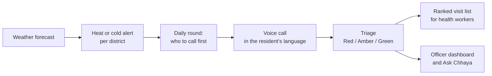

# Chhaya

**A multilingual voice AI that checks on vulnerable people during heatwaves and cold waves.**

When a weather warning is issued for a district, Chhaya phones elderly and at-risk residents in their own
language, asks how they are, and sorts them by need. Frontline health workers get a ranked list of who to
visit first, and regional officers see the whole picture in one place.

Built for the AI Builder Cup 2026, theme **Sustainability & Social Impact**.

**Live app:** https://chhaya-pgz66tuq7a-el.a.run.app/

## The problem

Extreme heat and cold hit the elderly, the isolated and the chronically ill hardest, and often quietly.
Health workers cannot knock on every door on the day a warning goes out. Chhaya makes those first
check-ins by phone, so workers can spend their time where it matters most.

## Try it

- **Talk to Chhaya.** Open *Try a call* and speak to the voice agent in your browser, in English, Hindi or
  Marwari. Watch the transcript, the recorded answers and the resulting risk level appear as you talk.
- **Regional officer view.** Districts under warning, the day's round of calls, urgent cases, a situation
  report, and **Ask Chhaya**, an assistant that answers plain-language questions about the live data.
- **Field worker view.** A health worker's visit list, ranked by need, with what to bring.
- **How we test Chhaya.** Results from simulated calls, assistant checks and speed tests, plus what has not
  been tested yet.

The app opens on live weather for 16 districts. Switch to **Demo data** for a fixed heat day with
simulated residents and calls.

## How it works



1. **Detect.** Twice a day Chhaya reads the forecast and raises an alert for districts at risk.
2. **Call.** It plans a round of calls, most vulnerable residents first, and the voice agent talks to each
   person in their language.
3. **Triage.** Answers are scored by fixed, transparent rules into Red (urgent), Amber or Green.
4. **Act.** Health workers get a ranked visit list; officers get a live overview, reports and an assistant.

## Built with

- **Gemini Live** (Vertex AI) for real-time voice conversations
- **Gemini** for case notes, round summaries and Ask Chhaya
- **Agent Development Kit (ADK)** for the Ask Chhaya assistant and its evaluation
- **Google Cloud:** Cloud Run, Firestore, Cloud Tasks, Cloud Scheduler, Secret Manager
- **Google Weather API** for forecasts
- **Twilio** for phone calls
- **FastAPI** (Python) backend and **React + TypeScript** web app

## Designed for safety

- **Rules decide the risk level, not the AI.** The AI can raise a case's urgency but can never hide a Red
  case.
- **No real personal data.** Districts and wards are real; every resident is synthetic.
- **No phone numbers in the app.** Screens and APIs never expose residents' numbers.
- **Only approved numbers are called.** Calls go only to numbers on an explicit allowlist, within
  permitted hours.
- **Humans approve actions.** Assistant-drafted assignments and notifications need a person's approval.

## How we test Chhaya

Simulated check-in calls in English, Hindi and Marwari, and Ask Chhaya checked question by question on a
fixed dataset. Every result is dated and labelled with the model that produced it. See
[EVALUATION.md](EVALUATION.md), or the *How we test Chhaya* page in the app.

## Run it locally

**Backend** (Python 3.11 or 3.12):

```bash
cd backend
python -m venv .venv
source .venv/bin/activate        # Windows: .venv\Scripts\activate
pip install -r requirements.txt
cp .env.example .env
uvicorn app.main:app --port 8080
```

The server starts with built-in sample data and keeps everything in memory. Run the tests with
`python -m pytest`.

**Web app** (Node.js 22 or newer), in a second terminal:

```bash
cd web
npm install
npm run dev
```

Open http://localhost:3000.

Live voice calls need a Google Cloud project with Vertex AI enabled (set `GCP_PROJECT` in `backend/.env`).
To explore the screens without one, set `FAKE_LIVE=true` and calls are played from a script. All settings
are described in `backend/.env.example`.

## Repository layout

| Path | What's there |
|---|---|
| `backend/` | API, voice agent, triage rules, Ask Chhaya and tests |
| `web/` | The web app for officers and health workers |
| `PRODUCT.md` | Who Chhaya is for and what it does |
| `DESIGN.md` | The visual design system |
| `EVALUATION.md` | How Chhaya is tested, and the results |

## Data

All resident data is synthetic. Only district and ward names are real, taken from official public lists.
Please don't add real people's details to this repository.
